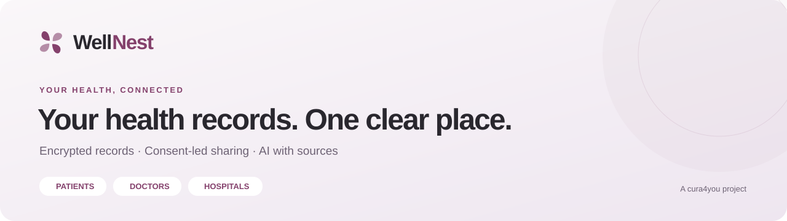
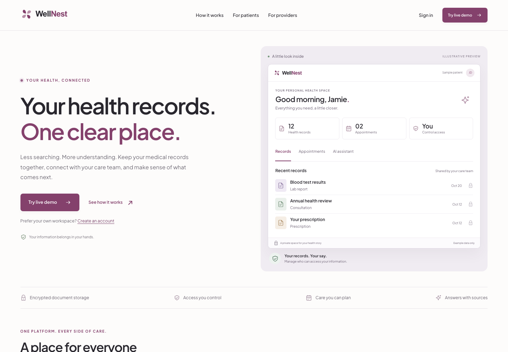
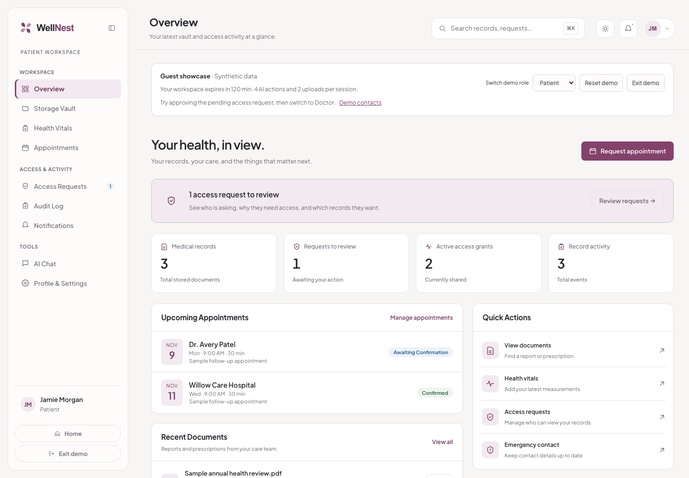
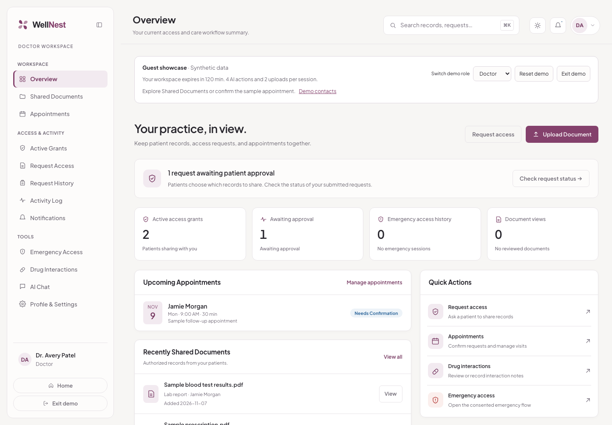
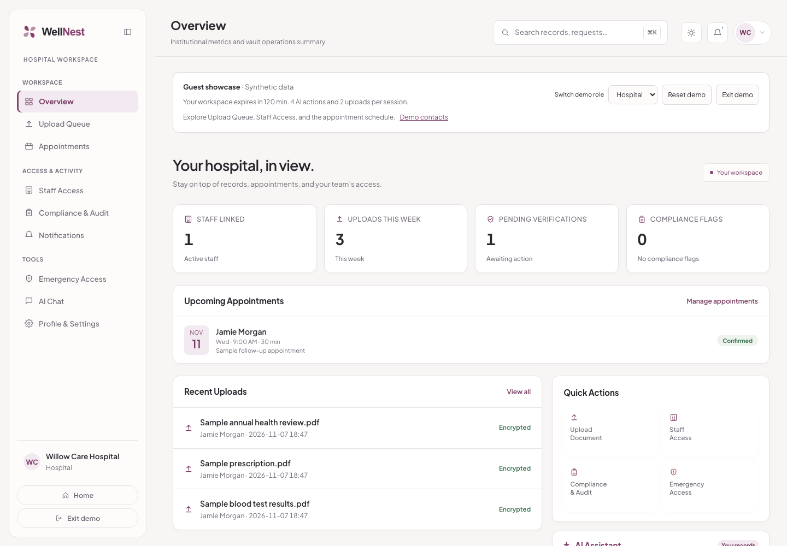
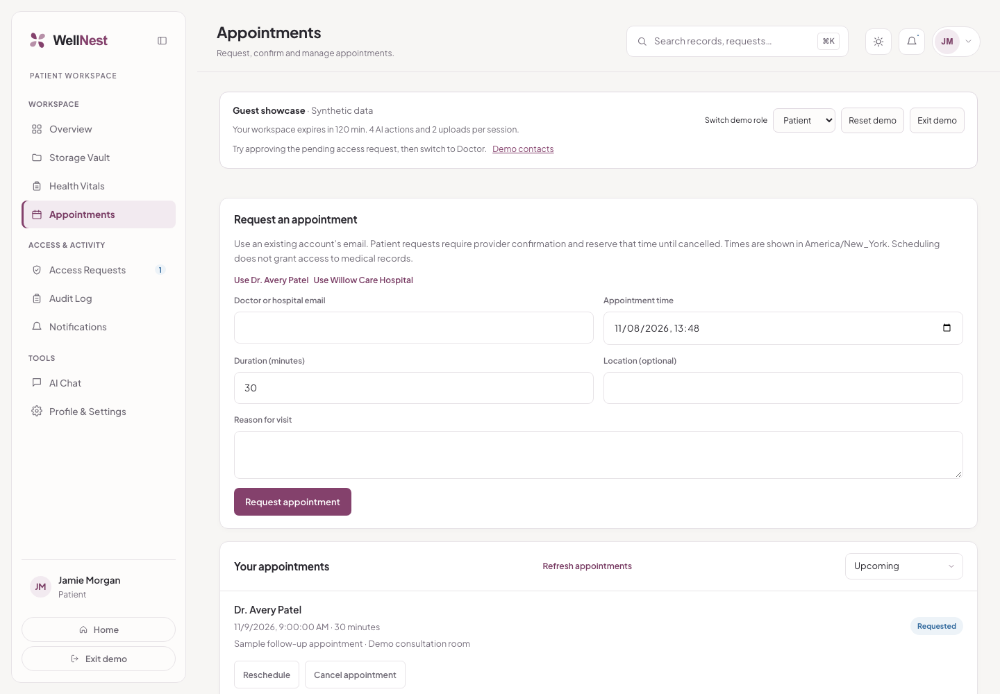
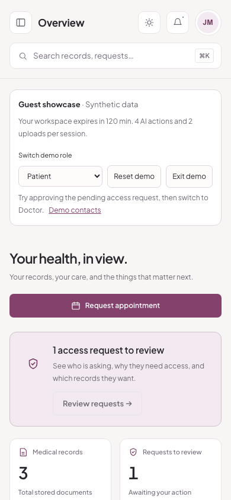
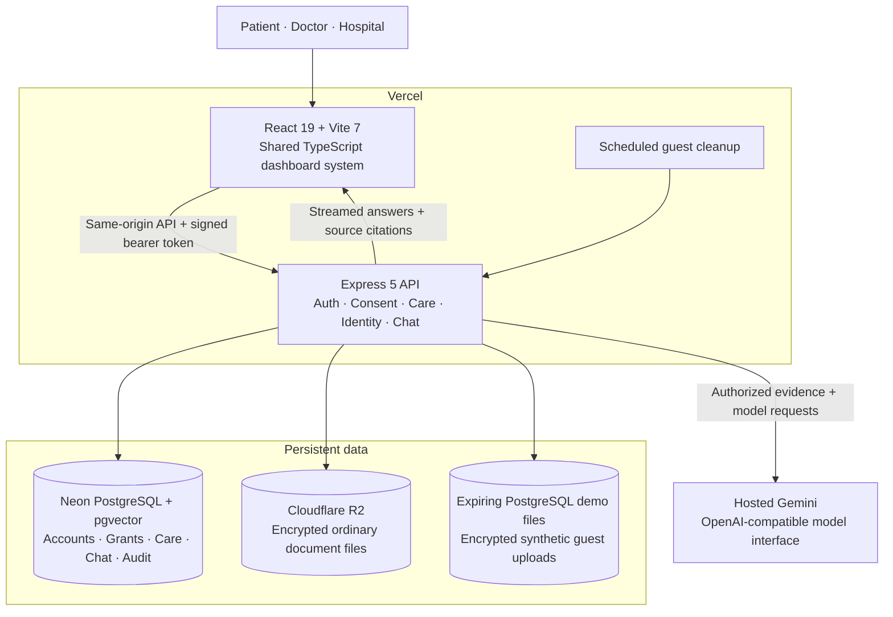
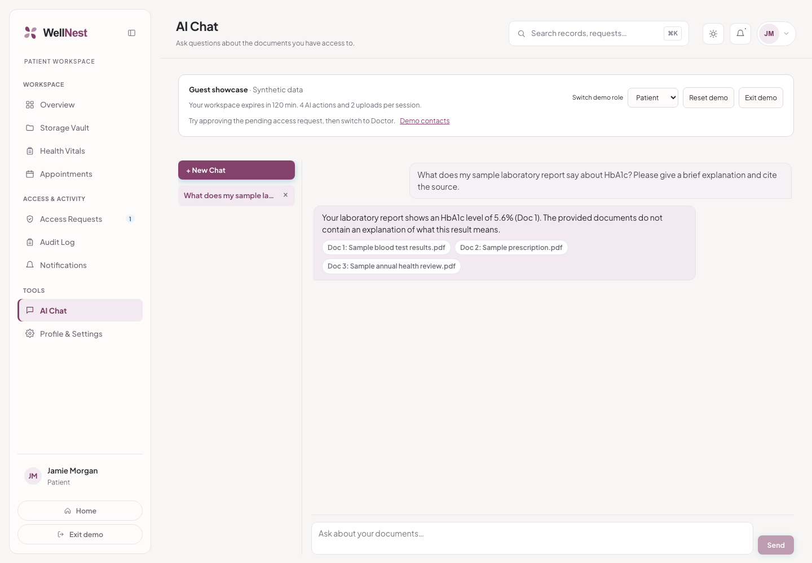

<p align="center">
  
</p>

<p align="center">
  <strong>A full-stack health records platform connecting patients, doctors, and hospitals.</strong><br />
  Keep records together. Control who can access them. Ask questions and inspect the sources.
</p>

<p align="center">
  <a href="https://wellnest-cura4you.vercel.app"><strong>Visit WellNest ↗</strong></a> &nbsp; · &nbsp;
  <a href="https://wellnest-cura4you.vercel.app/demo"><strong>Try the guest demo ↗</strong></a> &nbsp; · &nbsp;
  <a href="#architecture">Architecture</a> &nbsp; · &nbsp;
  <a href="#run-locally">Run locally</a> &nbsp; · &nbsp;
  <a href="#verification">Verification</a>
</p>

<p align="center">
  
  
  
  
  
  
</p>



## Explore it in three minutes

**No registration, shared password, or local setup required.** Open the [guest demo](https://wellnest-cura4you.vercel.app/demo) and choose a role. Each visitor gets a separate workspace with fictional records, appointments, and care-team accounts.

1. **Start as a patient.** Explore the record vault, vitals, appointments, and access requests.
2. **Approve the sample doctor's request.** Wait for the confirmation, then switch to **Doctor** using the guest toolbar. The newly shared report appears in Shared Documents.
3. **Schedule a follow-up.** As the patient, open Appointments and use the sample doctor shortcut. Switch to the doctor to see the same appointment.
4. **Ask the records a question.** In AI Chat, try: *“What HbA1c value is in my sample laboratory report? Cite the record.”* Open the citation to inspect the source.
5. **Explore the hospital view.** Switch roles, try the mobile layout, and use Reset demo to restore the sample workspace.

Guest workspaces expire after **two hours**. Each has **four AI requests, two uploads, and two resets**, with additional shared capacity limits. Reset keeps the original expiry and usage budgets. Exit removes the workspace; expired data also has a scheduled cleanup path. Use fictional information only. [How the sandbox works →](GUEST_DEMO.md)

## One design system. Three sides of care.

A shared dashboard shell, typography, plum palette, theme tokens, and accessible navigation keep the product consistent. Each role gets its own tools and permissions.

| Patient | Doctor | Hospital |
| --- | --- | --- |
| Browse and download personal records | Upload records for a patient | Upload and manage patient records |
| Approve requests and revoke grants | Request and use authorized access | Review upload queues and staff access |
| Enter vitals and request appointments | Schedule and manage appointments | Coordinate appointments |
| Review access history and notifications | Review grants, requests, and activity | Review compliance and access activity |
| Ask questions about accessible records | Summarize and query authorized records | Summarize and query authorized records |

### Your personal health space



<table>
  <tr>
    <td width="50%"></td>
    <td width="50%"></td>
  </tr>
  <tr>
    <td align="center"><strong>Doctor workspace</strong><br />Authorized records and the next patient interaction.</td>
    <td align="center"><strong>Hospital workspace</strong><br />Record operations and care-team activity.</td>
  </tr>
</table>

<details>
<summary><strong>See appointment scheduling and the mobile dashboard</strong></summary>



<p align="center"></p>

</details>

Screenshots above and below were captured from the deployed website using one isolated guest workspace, including a real hosted AI response. All displayed records and identities are synthetic. [Capture details →](docs/readme/capture-manifest.json)

## What is built

| Area | Implemented behavior |
| --- | --- |
| **Document vault** | Provider uploads, server-side file encryption, authorized viewing/downloads, document filters, and structured AI summaries. |
| **Consent and sharing** | Document access requests, patient approval/rejection, grants, expiry, revocation, and access-scoped retrieval. |
| **Care workflows** | Patient-entered vitals; patient requests and provider-created appointments; conflict checks, confirmation, rescheduling, and cancellation. |
| **Notifications** | Persistent in-app notifications, read state, and per-account notification preferences. |
| **AI assistant** | Streaming conversation, saved chat sessions, authorized retrieval, source citations, and an optional bounded read-only tool planner. |
| **Account security** | Password hashing, expiring signed sessions, server-side revocation, logout across devices, password changes, and single-use recovery links. |
| **Provider review** | Email-verification workflow, encrypted proof uploads, revisioned applications, and administrator review decisions. |
| **Clinical context** | Patient profile, clinician-recorded medication-interaction notes, and consent-aware, time-limited emergency access. |
| **Guest showcase** | Isolated synthetic accounts for all three roles, role switching, resets, expiry, database boundaries, and usage budgets. |

## Architecture

The application has a real backend and persistent data layer. React renders the experience; Express enforces permissions and coordinates records, care workflows, and AI. Production runs on **Vercel, Neon PostgreSQL, Cloudflare R2, and hosted Gemini**. Local development can use PostgreSQL, MinIO, and an optional Ollama adapter.



### A record's path through the system

1. **Upload and authorize.** The API checks the caller's role and target patient before accepting a record.
2. **Encrypt and persist.** Each file receives a random AES-256-GCM data key. The key is wrapped using a server-held keyring; metadata and permissions live in PostgreSQL, and ordinary encrypted files live in R2.
3. **Extract and index.** The ingestion pipeline extracts document text, chunks it, and stores text and embeddings for retrieval. Indexing readiness depends on the document and configured services.
4. **Share deliberately.** Access requests and grants determine which documents another role can read. Authorization is rechecked for downloads and AI tools.
5. **Answer with evidence.** Retrieval searches authorized document IDs, and the assistant streams an answer with links to its supporting records.

Guest files use encrypted, expiring PostgreSQL storage rather than permanent R2 objects. Guest retrieval searches scoped sample text using PostgreSQL full-text ranking, avoiding a new set of embedding calls for every visitor. Ordinary-account semantic retrieval uses pgvector.

<details>
<summary><strong>Repository map</strong></summary>

```text
src/
├── pages/                Landing, authentication, role dashboards, identity, demo
├── dashboard-v2/         Shared TypeScript shell, views, tokens, and care panels
├── components/           Brand, chat, document, and authentication components
├── context/              Session and guest-role lifecycle
└── services/             Frontend API clients
server/
├── src/app.js            Express composition and record routes
├── src/care.js           Vitals, scheduling, and participant permissions
├── src/identity.js       Verification, evidence, and administrator review
├── src/chat.js           Streaming chat and retrieval orchestration
├── src/chatAgent.js      Bounded planner and authorized read-only tools
├── src/embeddings.js     Extraction, chunking, indexing, and retrieval
├── src/crypto.js         File encryption and versioned key wrapping
├── src/demo*.js          Guest lifecycle, limits, and isolation
├── test/                 Deterministic backend tests
└── integration/          Real database/API guest checks
api/server.js             Vercel serverless entry point
db/migrations/            15 ordered SQL migrations
scripts/                  Migration, admin, key rotation, and cleanup tools
docs/                     Screenshots and verification evidence
```

</details>

## AI that can show its work



The assistant combines **retrieval-augmented generation** with an optional **read-only agent loop**. It can gather evidence through several tool calls before generating an answer, while the backend keeps every lookup inside the caller's current permissions.

| Tool capability | Purpose |
| --- | --- |
| `list_documents` | Find accessible records and their metadata. |
| `search_documents` | Locate relevant passages within authorized records. |
| `get_document_text` | Inspect additional text without loading every record into a prompt. |
| `get_health_profile` | Read the signed-in patient's own structured profile. |
| `list_drug_interactions` | Read the patient's recorded medication-interaction notes. |

The loop has step, time, and output limits; reports progress to the UI; audits tool reads; and can fall back to the existing RAG path when planning is unavailable. Guest sessions use a smaller two-step planner budget. Conversation history provides context, while current authorized evidence supports factual answers.

**Evaluation:** the documented full local evaluation passed **26 scenarios** using real Ollama, PostgreSQL/pgvector, API requests, and browser checks. It covered permission boundaries, revocation, missing evidence, hostile document text, provider failures, and disconnects. The hosted WellNest rollout separately verified cited chat and PDF summarization with Gemini. These are distinct test scopes; the full 26-scenario evaluation is not a hosted production certification. [Evaluation →](AGENT_EVALUATION.md) · [Agent runbook →](AGENTIC_CHAT_RUNBOOK.md)

## Security and trust boundaries

- **Server-side encryption:** random per-file keys, AES-256-GCM file encryption, and versioned wrapping keys kept outside the database. Authorized backend operations can decrypt files; this is not end-to-end encryption.
- **Access control:** role and document permissions are checked server-side. Guest requests also have workspace-scoped checks and relational database boundaries.
- **Session lifecycle:** HMAC-signed bearer tokens, account-version checks, revoked-token storage, and password-change invalidation.
- **Account recovery:** hashed, expiring, single-use email tokens; provider applications retain evidence versions and review history.
- **Traceability:** database audit records capture important access, sharing, and AI actions. They are not a cryptographically immutable ledger.
- **AI data boundary:** extracted text and embeddings are stored for retrieval, and authorized evidence can be sent to the configured AI provider. Encrypted file storage does not imply encrypted search indexes.

**Deployment scope:** this is a portfolio showcase using fictional demo data. Production deliberately runs provider review in portfolio mode; strict approval enforcement is available and tested separately. External verification/recovery email delivery still needs provider activation. Interaction notes are manually recorded, not an external drug-safety database. AI output is explanatory assistance, not a diagnosis or clinical validation. No regulatory compliance certification is claimed.

[Security operations →](SECURITY_OPERATIONS.md) · [Identity review →](IDENTITY_REVIEW.md) · [Guest isolation →](GUEST_DEMO.md)

## Run locally

**Prerequisites:** Node.js 24, npm, and PostgreSQL with the `vector` extension available. Use a hosted S3-compatible bucket or Docker for MinIO. A hosted model works without Ollama; local AI is optional.

```sh
git clone https://github.com/cura4you/WellNest.git
cd WellNest
npm ci
cp .env.example .env
```

Configure `.env` using the template. For a new local installation, the essentials are:

| Configuration | What to set |
| --- | --- |
| `DATABASE_URL` | Your local or hosted PostgreSQL connection string. |
| `SESSION_SECRET` | A long random secret; generate with `openssl rand -hex 32`. |
| `DOCUMENT_KEK_ID` | A key ID, such as `local-v1`. |
| `DOCUMENT_KEKS` | A JSON keyring, such as `{"local-v1":"<32-byte Base64 key>"}`. Generate the value with `openssl rand -base64 32`. |
| `VITE_API_BASE_URL` | `http://localhost:3001` for the local API. |
| `ALLOWED_ORIGINS` | Include `http://localhost:5177`. |
| `S3_*` | The template's local MinIO settings, or credentials for your hosted bucket. |
| `AI_BASE_URL`, `AI_MODEL`, `AI_API_KEY` | A configured OpenAI-compatible model endpoint and a model available to your account. |
| `EMBEDDING_*` | A compatible embeddings endpoint and model; use 768 dimensions to match the schema. |

Keep secrets in `.env` or your hosting provider's environment settings. Retain encryption keys securely: replacing them makes existing wrapped keys unreadable. Leave `VITE_ENABLE_MOCK_AUTH=false` for real backend development.

```sh
# Start local object storage if using the template's MinIO configuration.
docker compose up -d

# For a fresh local database; skip createdb if your database already exists.
createdb medivault
psql -d medivault -c 'CREATE EXTENSION IF NOT EXISTS vector;'

# Apply all pending migrations to DATABASE_URL from .env.
npm run db:migrate

# Frontend :5177 + API :3001
npm run dev:all
```

Open **http://localhost:5177**. The local `medivault` database/bucket names are retained compatibility identifiers; the application and repository are WellNest. On a hosted database, enable `vector` there before running migrations. The migration runner records applied files in `schema_migrations`.

<details>
<summary><strong>Optional features and deployment configuration</strong></summary>

- **Local AI:** Ollama can provide the chat/vision API. It is not required for the hosted application. Configure a model supported by your machine rather than downloading a large model just to browse the UI.
- **Agent:** set `CHAT_AGENT_ENABLED=true` and choose a tool-capable `AI_AGENT_MODEL`. See the agent runbook for budgets and fallback behavior.
- **Guest demo:** set `DEMO_ENABLED=true`, optionally `DEMO_AI_MODEL`, and configure `CRON_SECRET` for protected cleanup. See the guest runbook before exposing it publicly.
- **Identity/recovery:** configure `APP_PUBLIC_URL`, `RESEND_API_KEY`, and `AUTH_EMAIL_FROM`; set `PROVIDER_APPROVAL_REQUIRED=true` when you intend to enforce reviewed provider identities. See the identity runbook for administrator bootstrap.
- **Vercel:** `vercel.json` builds the frontend and routes `/api/*`, `/auth/*`, `/demo/*`, and `/health` to `api/server.js`; the public `/demo` chooser remains a client route. Production uses the existing `wellnest` project and a configured 300-second function maximum. Keep AI deadlines within the actual host limits and ensure the object bucket already exists.
- **Production frontend:** leave `VITE_API_BASE_URL` unset to use same-origin rewrites, and keep mock authentication disabled. Configure database, wrapping keys, storage, AI, public origin, allowed origins, and cleanup credentials on the server.
- **Repository connection:** local Git pushes to `cura4you/WellNest`. The current release was deployed with the Vercel CLI; automatic deployments still require the Vercel GitHub app to be installed for the organization and connected to this repository.

```sh
npm run build
vercel deploy --prod --scope mohammad-petiwalas-projects
```

The scoped deployment command is for this project's existing owner. For your own deployment, link your own Vercel project and configure its environment first. Check `/health` after deployment. [Transition and rollout details →](WELLNEST_TRANSITION.md)

</details>

## Verification

The latest WellNest rollout includes the following evidence. Counts describe separate suites, not unique tests added together, and do not imply every possible user action was exhaustively tested.

| Scope | Result | Evidence |
| --- | --- | --- |
| Deterministic backend tests | 50 passed | `npm test`; [rollout record](WELLNEST_TRANSITION.md#verified-rollout--2026-11-07) |
| Guest API integration | 8 groups passed against isolated PostgreSQL and HTTP | [Guest implementation and checks](GUEST_DEMO.md) |
| Shared dashboard UI | 20 groups passed; three roles, six widths, light/dark themes | [Report](docs/wellnest-transition/dashboard-report.json) |
| Hosted homepage | Links, preview tabs, keyboard access, and 13 viewport widths passed | [Report](docs/wellnest-transition/homepage-report.json) |
| Hosted guest workflow | 6 groups passed, including sharing, isolation, cited AI, summaries, reset, and exit | [Report](docs/wellnest-transition/guest-hosted-report.json) |
| Hosted rebrand and scheduling | 12 public/account routes, three dashboards, and persisted appointment checked | [Report](docs/wellnest-transition/brand-and-scheduling-report.json) |
| Full local agent evaluation | 26 scenarios passed with a live model and database | [Report](docs/agent-live-verification.json) |

```sh
npm test
npm run lint
npx tsc --noEmit
npm run build

# Integration/browser suites require their documented local services.
npm run test:demo:api
npm run test:e2e:demo
npm run test:e2e:care
npm run test:e2e:security
npm run test:e2e:identity
npm run test:e2e:agent
```

The browser drivers use Playwright installed in `.claude/skills/run-medivault/`. Install its dependencies and Chromium there before the first browser run:

```sh
npm --prefix .claude/skills/run-medivault ci
(cd .claude/skills/run-medivault && npx playwright install chromium)
```

 Security and identity suites share ports and should run sequentially. [Care workflow setup →](CARE_WORKFLOWS.md)

## Recent milestones and next steps

**Shipped:** consistent dashboards across all three roles; real vitals, scheduling, and notification preferences; cited RAG and bounded agent tools; wrapped document keys and session revocation; provider review workflows; isolated guest showcase; the WellNest rebrand and organization repository transition.

**Next:** activate and verify external account email delivery; finish the organization-to-Vercel Git connection; add CI and operational monitoring; validate backup restores; complete the legacy storage/proof inventory. Hospital-system interoperability and a native mobile app remain future work, not current features.

## Project and credits

WellNest is maintained under **[cura4you](https://github.com/cura4you)** by [Mohammad Petiwala](https://github.com/moh0405) and [Saniya Desai](https://github.com/saniyadesai). It evolved from MediVault; the repository retains its original development history and contributor attribution. See the [commit history](https://github.com/cura4you/WellNest/commits/main/) for authorship.

<p align="center"><strong>Less searching. More understanding. Your care, connected.</strong></p>
